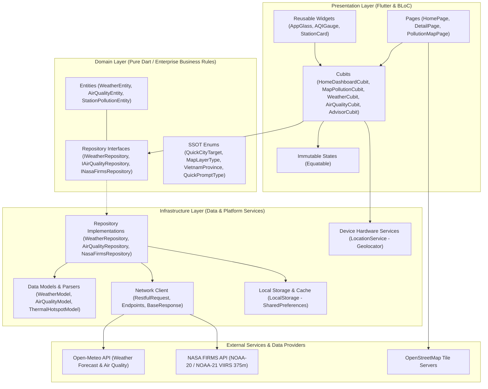
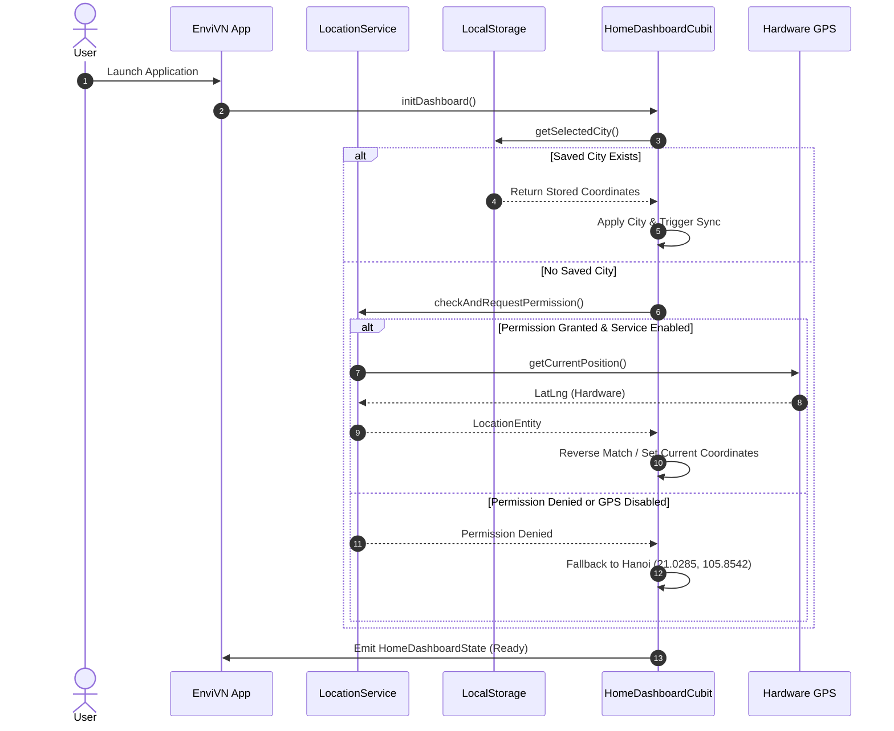
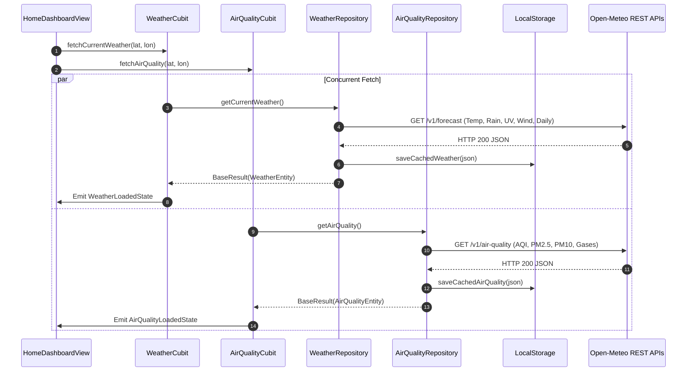
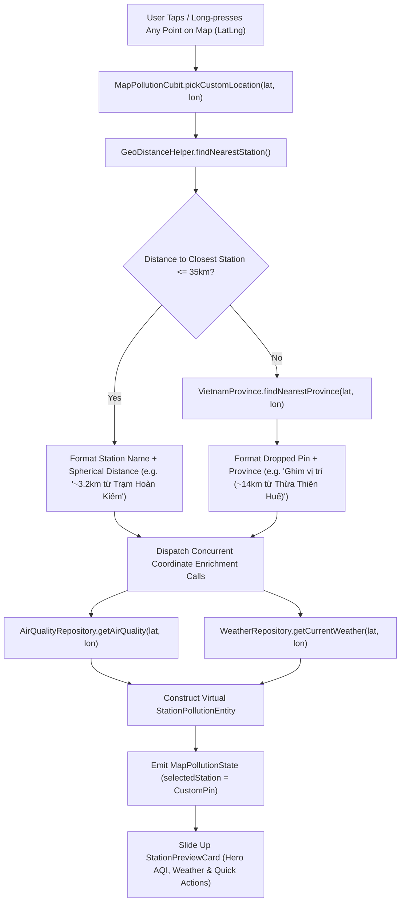
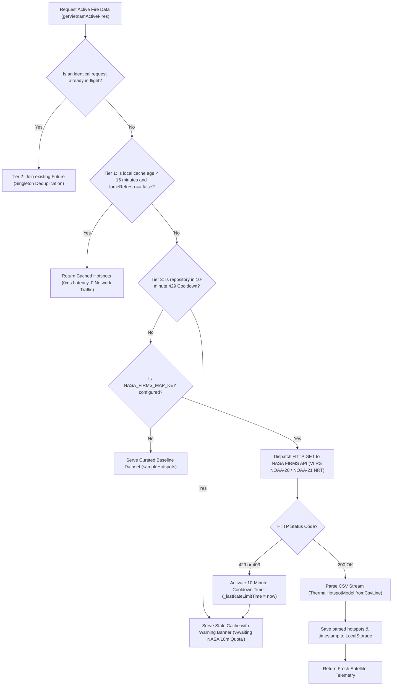
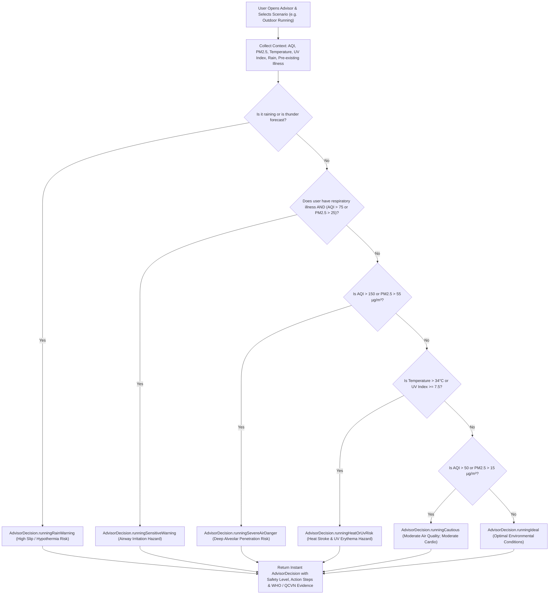

<p align="center">
  
</p>

<h1 align="center">EnviVN</h1>

<p align="center">
  <strong>High-Precision Environmental Intelligence, Real-Time Microclimate Forecasting, Urban Flood Blackspots & Satellite Thermal Early-Warning System for Vietnam</strong>
</p>

<p align="center">
  <a href="https://flutter.dev/"></a>
  <a href="https://dart.dev/"></a>
  <a href="#"></a>
  <a href="#"></a>
  <a href="#"></a>
  <a href="LICENSE"></a>
</p>

<p align="center">
  
  
  
</p>

---

## 📑 Table of Contents

- [Overview & Mission](#-overview--mission)
- [Application Screenshots & UI Showcase](#-application-screenshots--ui-showcase)
- [Key Features](#-key-features)
- [System Architecture](#-system-architecture)
  - [Architectural Principles](#architectural-principles)
  - [Layer Hierarchy](#layer-hierarchy)
  - [Directory Structure](#directory-structure)
- [Operational Workflows & System Flows](#-operational-workflows--system-flows)
  - [1. App Initialization & Location Resolution Flow](#1-app-initialization--location-resolution-flow)
  - [2. Weather & Air Quality Synchronization](#2-weather--air-quality-synchronization)
  - [3. Interactive GIS Map & Dropped Pin Resolution](#3-interactive-gis-map--dropped-pin-resolution)
  - [4. NASA FIRMS 3-Tier Quota Protection Engine](#4-nasa-firms-3-tier-quota-protection-engine)
  - [5. Deterministic Environmental Health Advisor](#5-deterministic-environmental-health-advisor)
- [Mathematical & Scientific Formulations](#-mathematical--scientific-formulations)
  - [Spherical Great-Circle Distance (Haversine Formula)](#spherical-great-circle-distance-haversine-formula)
  - [NOAA Apparent Heat Index (Rothfusz Regression)](#noaa-apparent-heat-index-rothfusz-regression)
  - [US EPA Air Quality Index Linear Interpolation](#us-epa-air-quality-index-linear-interpolation)
  - [Satellite Thermal Radiance & FRP Classification](#satellite-thermal-radiance--frp-classification)
  - [Urban Flood Risk Vulnerability Matrix](#urban-flood-risk-vulnerability-matrix)
- [Prerequisites & System Requirements](#-prerequisites--system-requirements)
- [Environment Configuration (`.env`)](#-environment-configuration-env)
- [Getting Started (Quick Run via CLI)](#-getting-started-quick-run-via-cli)
- [IDE Setup Guides](#-ide-setup-guides)
  - [Visual Studio Code (VS Code)](#visual-studio-code-vs-code)
  - [Android Studio](#android-studio)
  - [Xcode & iOS (macOS)](#xcode--ios-macos)
- [Testing & Quality Assurance](#-testing--quality-assurance)
- [Troubleshooting & FAQ](#-troubleshooting--faq)
- [Project Roadmap](#-project-roadmap)
- [Contributing Guidelines](#-contributing-guidelines)
- [License & Data Attributions](#-license--data-attributions)

---

## 🌍 Overview & Mission

**EnviVN** is an enterprise-grade, cross-platform environmental intelligence and disaster risk early-warning application engineered in Flutter. Designed specifically around Vietnam's complex geographical, meteorological, and urban realities, EnviVN aggregates real-time meteorological observations, multi-pollutant air quality indexes, chronic urban flood vulnerability matrices, and satellite-detected thermal radiation hotspots into a seamless, high-performance visual experience.

### Why EnviVN?

Vietnam faces distinct environmental challenges across its distinct eco-geographical zones:
* **Severe Tropical Monsoons & Localized Flash Floods:** Rapid-onset heavy precipitation frequently overwhelms legacy drainage infrastructure in major metropolises like Hanoi and Ho Chi Minh City.
* **Complex Industrial & Urban Air Pollution:** Elevated concentrations of fine particulate matter ($\text{PM}_{2.5}$, $\text{PM}_{10}$), nitrogen dioxide, and ozone in rapid-growth industrial corridors require actionable, localized public health advisories.
* **Agricultural Residue Burning & Wildfire Hotspots:** Seasonal biomass combustion and forest fire risks during the dry seasons in the Central Highlands (Tây Nguyên) and the Northwest demand near-real-time satellite monitoring.
* **Full Territorial Sovereignty Coverage:** Built-in GIS bounds, administrative gazetteers, and monitoring points natively include all 63 provinces and municipalities, as well as the **Hoàng Sa** (Paracel) and **Trường Sa** (Spratly) archipelagos.

EnviVN bridges the gap between raw scientific remote-sensing telemetry and everyday citizens through a privacy-respecting, zero-latency deterministic advisory engine wrapped in a fluid Liquid Glass UI.

---

## 📱 Application Screenshots & UI Showcase

The application's interface is built from the ground up using modern dark-mode aesthetic principles with frosted glassmorphism accents (`liquid_glass_renderer`):

| Overview Dashboard | 24-Hour Detailed Forecast | Multi-Layer Environmental Map |
| :---: | :---: | :---: |
|  |  |  |
| *Real-time AQI gauge, temperature, apparent heat index, and quick status metrics* | *Interactive 24h temperature curve, hourly pollutant bars, and 7-day outlook* | *GIS multi-layer engine: Weather, AQI, Thermal Radiance, and Urban Flood points* |

| Custom Dropped Pin Resolution | Satellite Thermal Hotspots (NASA) | Environmental Health Advisor |
| :---: | :---: | :---: |
|  |  |  |
| *Tap-to-pin anywhere in Vietnam with automated province distance calculation* | *NOAA-20/21 VIIRS 375m active thermal anomaly and Fire Radiative Power (MW)* | *Instant deterministic safety evaluation for running, ventilation, and family* |

> [!NOTE]
> Screenshots are stored in the `screenshots/` directory. Place your captured mockups or device screen recordings in this directory using the corresponding filenames.

---

## ✨ Key Features

### ⛅ 1. Hyper-Localized Weather & Microclimate Intelligence
* **Real-time Core Metrics:** Ambient dry-bulb temperature (°C), NOAA Apparent Heat Index (°C), relative humidity (%), surface barometric pressure (hPa), wind speed (km/h), and solar UV index.
* **24-Hour Dynamic Forecasting:** High-resolution hourly curves illustrating temperature transitions, rainfall probabilities, and WMO weather condition iconography.
* **7-Day Synoptic Outlook:** Weekly overview tracking daily maximums, minimums, and aggregated precipitation sums powered by Open-Meteo.

### 💨 2. Multi-Pollutant Air Quality Index (AQI) Analytics
* **Bilingual Index Standards:** Real-time US EPA Standard Air Quality Index (0–500) paired with European Air Quality Index (AQI-EU).
* **Deep Contaminant Profiling:** Explicit concentration measurements for Fine Particulates ($\text{PM}_{2.5}$, $\text{PM}_{10}$), Carbon Monoxide ($\text{CO}$), Nitrogen Dioxide ($\text{NO}_2$), Sulphur Dioxide ($\text{SO}_2$), and Ground-level Ozone ($\text{O}_3$) measured in $\mu\text{g}/\text{m}^3$.
* **Health Impact Thresholds:** Categorized into 6 official color-coded health risk tiers with actionable guidance.

### 🗺️ 3. 4-in-1 GIS Multi-Layer Environmental Map
* **Layer 1: Weather & Atmosphere:** Synoptic visualization of ambient temperature, wind vectors, and current atmospheric conditions across national monitoring stations.
* **Layer 2: Air Quality (AQI):** Interactive station pins displaying color-coded air hazard ratings and $\text{PM}_{2.5}$ densities.
* **Layer 3: Satellite Thermal Radiance & Fire Hotspots:** Direct ingestion of active thermal infrared detections from NASA FIRMS (NOAA-20 and NOAA-21 VIIRS 375m sensors) with Fire Radiative Power (MW) and confidence grading.
* **Layer 4: Urban Flood Vulnerability:** Curated spatial inventory of historical urban flood blackspots across Vietnam's major metropolitan centers, evaluated in real time against live precipitation thresholds ($>20\text{ mm/h}$).

### 📍 4. Custom Dropped Pin & Nearest-Neighbor GIS Resolution
* **Free-Coordinate Interactivity:** Long-press or tap any coordinate within Vietnam's terrestrial landmass or exclusive economic maritime zone.
* **Automated Geographic Contextualization:** Computes spherical great-circle distances via the Haversine formula to the closest active monitoring station; if $>35\text{ km}$, automatically resolves the nearest Vietnamese administrative province.
* **On-Demand Micro-Station Enrichment:** Dispatches concurrent asynchronous telemetry requests to construct an on-the-fly virtual monitoring card.

### 🛰️ 5. NASA FIRMS Ingestion Engine with 3-Tier Quota Shield
* **15-Minute On-Device TTL Cache:** Eliminates redundant calls when toggling layers; serves instantaneous responses ($0\text{ ms}$).
* **In-Flight Singleton Deduplication:** Coalesces overlapping network calls into a single shared asynchronous execution.
* **Automatic Cooldown & Stale-While-Revalidate Fallback:** Gracefully absorbs HTTP 429 / 403 quota responses with an automatic 10-minute cooldown, falling back to cached telemetry or curated field baseline datasets.

### 🧠 6. Deterministic Environmental Health & Activity Advisor
* **100% Deterministic (Zero Hallucination, 0ms Latency):** Evaluates real-time environmental vectors against strict medical and environmental benchmarks without external LLM dependencies.
* **4 Operational Scenarios:**
  * 🏃 **Outdoor Running & Cardio:** Evaluates heat stroke index, ozone, PM2.5, rain probability, and lightning risk.
  * 🪟 **Indoor Ventilation:** Advises whether to seal windows or exchange fresh air based on outdoor particulate counts.
  * 👶 **Children & Elderly Protection:** Specialized precautions for vulnerable populations and pre-existing respiratory conditions.
  * 🛵 **Daily Commuting & Travel:** Advises appropriate mask grades (e.g., N95 vs standard surgical) and wet-weather gear.
* **Regulatory Benchmarking:** Adheres to the World Health Organization (WHO) Global Air Quality Guidelines and Vietnam National Technical Regulation **QCVN 05:2023/BTNMT**.

### 💎 7. Fluid Liquid Glass UI & Enterprise Offline Caching
* **Liquid Glass Bottom Bar:** Custom blur and specular highlight bottom navigation bar built on custom shaders.
* **Offline-First Persistence:** Automatically synchronizes and caches weather, AQI, and thermal datasets to local storage (`SharedPreferences`), providing graceful degradation during network blackouts.
* **Compact & Responsive:** Layouts are rigorously unit-tested against ultra-narrow viewports ($320\text{px}$) to guarantee zero RenderFlex overflow errors.

---

## 🏛 System Architecture

EnviVN is architected following the **Clean Architecture** paradigm, married with the **BLoC/Cubit** reactive state management pattern and the **Single Source of Truth (SSOT)** architectural contract.



### Architectural Principles

1. **Separation of Concerns:** The domain layer contains zero Flutter framework dependencies (`flutter/material.dart`), ensuring high testability and platform-agnostic business logic.
2. **Single Source of Truth (SSOT):** Critical metadata (such as Vietnam's 63 provinces, national coordinates, monitoring stations, and map layer configurations) are encapsulated in immutable Domain Enums and Entities (`VietnamProvince`, `QuickCityTarget`, `MapLayerType`).
3. **Repository Pattern with Result Unification:** All infrastructure operations return an immutable `BaseResult<T>`, encapsulating either payload data or standardized error metadata (`code`, `message`), preventing unhandled exception bubbling.
4. **Predictable Unidirectional Data Flow:** User actions dispatch intents to Cubits $\rightarrow$ Cubits invoke Repositories $\rightarrow$ Repositories negotiate cache and network $\rightarrow$ Cubits emit immutable new states $\rightarrow$ UI updates reactively.

---

### Directory Structure

```
lib/
├── main.dart                                   # Application bootstrap, DI init & global providers
└── src/
    ├── common/                                 # Cross-cutting constants, extensions & mathematical helpers
    │   ├── constants/                          # UIColors, AppStrings, theme definitions
    │   ├── extensions/                         # BuildContext extensions (context_x.dart)
    │   └── utils/                              # GeoDistanceHelper, HeatIndexHelper, AQIHelper, WeatherCodeHelper
    ├── core/                                   # Application core infrastructure & base classes
    │   ├── di/                                 # Service locator setup (GetIt)
    │   ├── domain/entities/                    # BaseResult, BaseResponse, generic contracts
    │   ├── infrastructure/
    │   │   ├── configs/                        # Environment config reader (EnvConfig)
    │   │   ├── datasources/
    │   │   │   ├── local/                      # LocalStorage (SharedPreferences wrapper)
    │   │   │   └── network/                    # RestfulRequest, Endpoints, HTTP methods
    │   │   └── services/                       # Hardware location services (LocationService)
    │   └── presentation/widgets/               # Generic UI atoms (AppButton, AppText, Loading, ErrorWidget)
    ├── features/
    │   ├── advisor/                            # Deterministic Health & Activity Advisory Engine
    │   │   ├── domain/entities/                # AdvisorDecision, QuickPromptType, SafetyLevel, AdvisorEvidence
    │   │   └── presentation/                   # AdvisorCubit, AdvisorModalSheet, DecisionCard
    │   ├── air_quality/                        # Air Quality Feature (Open-Meteo Air Quality API)
    │   │   ├── domain/                         # AirQualityEntity, IAirQualityRepository
    │   │   ├── infrastructure/                 # AirQualityRepository, AirQualityModel, AirQualityPaths
    │   │   └── presentation/                   # AirQualityCubit, AQIGaugeWidget, PollutantsGrid
    │   ├── home/                               # Central Application Shell & Bottom Navigation
    │   │   ├── domain/entities/                # CityEntity
    │   │   └── presentation/                   # HomeDashboardCubit, HomePage, LiquidGlassBottomBar, CitySheet
    │   ├── map_pollution/                      # Multi-Layer GIS Environmental Map
    │   │   ├── domain/
    │   │   │   ├── entities/                   # StationPollutionEntity, MapLayerType, QuickCityTarget, FloodBlackspot
    │   │   │   └── interfaces/                 # IMapPollutionRepository, INasaFirmsRepository
    │   │   ├── infrastructure/
    │   │   │   ├── models/                     # StationPollutionModel, ThermalHotspotModel (CSV parser)
    │   │   │   ├── paths/                      # MapPollutionPaths, NasaFirmsPaths
    │   │   │   └── repositories/               # MapPollutionRepository, NasaFirmsRepository (3-Tier Cache)
    │   │   └── presentation/                   # MapPollutionCubit, PollutionMapPage, StationPreviewCard, Markers
    │   └── weather/                            # Meteorological Forecast Feature (Open-Meteo Forecast API)
    │       ├── domain/                         # WeatherEntity, IWeatherRepository
    │       ├── infrastructure/                 # WeatherRepository, WeatherModel, WeatherPaths
    │       └── presentation/                   # WeatherCubit, TwentyFourHourDetailPage, WeatherHeroDetailCard
    └── shared/                                 # Shared presentation widgets & router keys
        ├── router/                             # GlobalKeyManager, route paths
        └── widgets/                            # AppGlass (frosted glassmorphism container), AppTopToast
```

---

## 🔄 Operational Workflows & System Flows

### 1. App Initialization & Location Resolution Flow



### 2. Weather & Air Quality Synchronization



### 3. Interactive GIS Map & Dropped Pin Resolution



### 4. NASA FIRMS 3-Tier Quota Protection Engine

To guarantee zero service disruptions under the NASA FIRMS rate constraint ($5,000\text{ requests} / 10\text{ minutes}$ per `MAP_KEY`), the `NasaFirmsRepository` enforces a multi-tier protective pipeline:



### 5. Deterministic Environmental Health Advisor



---

## 📐 Mathematical & Scientific Formulations

### Spherical Great-Circle Distance (Haversine Formula)

Implemented in `GeoDistanceHelper`, computing distance $d$ between two points on Earth with mean radius $R = 6,371.0\text{ km}$:

$$\Delta \varphi = \varphi_2 - \varphi_1, \quad \Delta \lambda = \lambda_2 - \lambda_1$$

$$a = \sin^2\left(\frac{\Delta \varphi}{2}\right) + \cos(\varphi_1) \cdot \cos(\varphi_2) \cdot \sin^2\left(\frac{\Delta \lambda}{2}\right)$$

$$c = 2 \cdot \operatorname{atan2}\left(\sqrt{a}, \sqrt{1 - a}\right), \quad d = R \cdot c$$

**Display Precision Standards:**
* $d < 10\text{ km}$: Formatted to one decimal place (e.g., `~3.4 km`).
* $d \ge 10\text{ km}$: Rounded to the nearest integer (e.g., `~25 km`).

### NOAA Apparent Heat Index (Rothfusz Regression)

Implemented in `HeatIndexHelper`, calculating perceived apparent temperature based on dry-bulb temperature ($T$ in °F) and relative humidity ($RH$ in %):

$$\begin{aligned}
\text{HI} = &-42.379 + 2.04901523\,T + 10.14333127\,RH - 0.22475541\,T\,RH \\
&- 0.00683783\,T^2 - 0.05481717\,RH^2 + 0.00122874\,T^2\,RH \\
&+ 0.00085282\,T\,RH^2 - 0.00000199\,T^2\,RH^2
\end{aligned}$$

**Physiological Hazard Classifications:**
| Heat Index (°C) | Risk Classification | Clinical Risk & Manifestations |
| :--- | :--- | :--- |
| $< 27^\circ\text{C}$ | **Safe / Normal** | Negligible thermal strain during standard activity |
| $27^\circ\text{C} - 32^\circ\text{C}$ | **Caution** | Fatigue possible with prolonged exposure and physical exertion |
| $32^\circ\text{C} - 41^\circ\text{C}$ | **Extreme Caution** | Heat cramps and heat exhaustion possible; continuous hydration advised |
| $\ge 41^\circ\text{C}$ | **Danger / Extreme Danger** | Heat stroke imminent with continued outdoor physical activity |

### US EPA Air Quality Index Linear Interpolation

Calculated via piecewise linear interpolation across pollutant concentration breakpoints:

$$I = \frac{I_{\text{high}} - I_{\text{low}}}{C_{\text{high}} - C_{\text{low}}} \cdot (C - C_{\text{low}}) + I_{\text{low}}$$

Where:
* $C$: Measured pollutant concentration (e.g., $\text{PM}_{2.5}$ in $\mu\text{g}/\text{m}^3$).
* $[C_{\text{low}}, C_{\text{high}}]$: Concentration breakpoint interval enclosing $C$.
* $[I_{\text{low}}, I_{\text{high}}]$: Corresponding index breakpoint interval.

**Air Quality Breakpoint Thresholds:**
| US AQI Range | Descriptor | Health Implications & Advisory |
| :---: | :--- | :--- |
| **0 – 50** | **Good (Tốt)** | Air quality is considered satisfactory; air pollution poses little or no risk. |
| **51 – 100** | **Moderate (Trung bình)** | Acceptable; sensitive individuals should consider limiting prolonged outdoor exertion. |
| **101 – 150** | **Unhealthy for Sensitive Groups (Kém)** | Children, older adults, and individuals with respiratory issues may experience symptoms. |
| **151 – 200** | **Unhealthy (Xấu)** | Everyone may begin to experience health effects; wear an N95 protective mask outdoors. |
| **201 – 300** | **Very Unhealthy (Rất xấu)** | Health alert: the risk of health effects is increased for everyone; avoid outdoor exertion. |
| **301+** | **Hazardous (Nguy hại)** | Health warning of emergency conditions; entire population is likely to be affected. |

### Satellite Thermal Radiance & FRP Classification

EnviVN processes Band I4 ($375\text{ m}$) high-resolution thermal detections from the VIIRS instrument aboard the NOAA-20 and NOAA-21 satellite constellations:

* **Brightness Temperature Conversion:**
  $$T_{^\circ\text{C}} = T_{\text{Kelvin}} - 273.15$$
* **Fire Radiative Power (FRP in Megawatts):** Quantifies instantaneous radiant heat output from combustion:
  * $\text{FRP} \ge 20.0\text{ MW}$: Large-scale / high radiative output thermal emission.
  * $\text{FRP} < 20.0\text{ MW}$: Moderate / localized surface thermal anomaly.
* **Geographical Terrain Context:** Dynamically correlates detected coordinates against Vietnam's Highland (Tây Nguyên / Northwest) vs. Lowland Delta polygons to distinguish seasonal agricultural biomass burn-off from highland canopy wildfires.

### Urban Flood Risk Vulnerability Matrix

Evaluates real-time localized rainfall telemetry against a curated spatial database of historical urban flood blackspots (`FloodBlackspot.vietnamBlackspots`):

$$\text{isHighFloodRisk} = \left(\text{precipitation} \ge 20.0\text{ mm/h}\right) \;\land\; \left(\exists\,\text{blackspot} : \text{distance}(\text{user}, \text{blackspot}) \le 2.5\text{ km}\right)$$

---

## 📦 Prerequisites & System Requirements

Before setting up EnviVN, ensure your development workstation satisfies the following requirements:

| Component | Minimum Version | Recommended Version | Notes |
| :--- | :--- | :--- | :--- |
| **Flutter SDK** | `3.22.0` | `3.29.x` or later | Channels: `stable` |
| **Dart SDK** | `3.12.0` | Included with Flutter | Null-safety enforced |
| **Java Development Kit (JDK)** | **JDK 17** | **OpenJDK 17 / Eclipse Temurin 17** | **Mandatory** for Gradle 8.x & Kotlin DSL (`.gradle.kts`) |
| **Android Studio** | Koala / Iguana | Latest Stable | Required plugins: *Flutter*, *Dart* |
| **Android SDK** | API 21 (Lollipop) | API 34+ (compileSdk / targetSdk) | Android NDK installed |
| **Xcode (macOS only)** | 15.0 | 16.x or later | Required for iOS & macOS compilation |
| **CocoaPods (macOS only)** | 1.14.0 | Latest (`gem install cocoapods`) | Manages iOS native frameworks |
| **Git** | 2.30+ | Latest | Version control |

---

## ⚙️ Environment Configuration (`.env`)

EnviVN utilizes a decoupled environment configuration architecture managed by `EnvConfig` (`lib/src/core/infrastructure/configs/env_config.dart`).

### Step 1: Create your `.env` file

Copy the provided `.env_example` template to `.env` in the root of the project:

```bash
# On Windows PowerShell:
Copy-Item .env_example .env

# On macOS / Linux:
cp .env_example .env
```

### Step 2: Environment Variables Reference

| Variable Name | Default Value | Description |
| :--- | :--- | :--- |
| `APP_NAME` | `EnviVN` | Application brand name |
| `APP_ENV` | `development` | Runtime stage: `development`, `staging`, `production` |
| `APP_DEBUG` | `true` | Enables detailed logger output for REST transactions |
| `OPEN_METEO_WEATHER_BASE_URL` | `https://api.open-meteo.com` | Base URL for weather forecasting endpoints (No auth required) |
| `OPEN_METEO_AIR_QUALITY_BASE_URL` | `https://air-quality-api.open-meteo.com` | Base URL for atmospheric chemistry & AQI endpoints |
| `OPEN_METEO_GEOCODING_BASE_URL` | `https://geocoding-api.open-meteo.com` | Reverse and forward geocoding resolution |
| `IP_API_BASE_URL` | `http://ip-api.com/json` | Privacy-compliant fallback IP geolocation |
| `OSM_TILE_URL` | `https://tile.openstreetmap.org/{z}/{x}/{y}.png` | Raster tile template URL for OpenStreetMap layer |
| `MAP_USER_AGENT` | `com.envivn.envivn` | Custom User-Agent header passed to OSM tile servers |
| `NASA_FIRMS_BASE_URL` | `https://firms.modaps.eosdis.nasa.gov/api` | NASA FIRMS active fire API endpoint |
| `NASA_FIRMS_MAP_KEY` | *(Optional / Free)* | **Personal NASA FIRMS MAP_KEY** for satellite fire ingestion |

> [!TIP]
> **How to obtain a free NASA FIRMS MAP_KEY (takes 60 seconds):**
> 1. Visit [NASA FIRMS MAP_KEY Request Portal](https://firms.modaps.eosdis.nasa.gov/api/map_key/).
> 2. Submit your email address.
> 3. Check your inbox, copy the 32-character key, and paste it into `.env`:
>    ```env
>    NASA_FIRMS_MAP_KEY=your_32_char_nasa_firms_key_here
>    ```
> *If left empty, EnviVN gracefully defaults to its curated field-verified hotspot database (`ThermalHotspotModel.sampleHotspots`).*

---

## 🚀 Getting Started (Quick Run via CLI)

```bash
# 1. Clone the repository
git clone https://github.com/your-username/EnviVN.git
cd EnviVN

# 2. Initialize environment configuration
cp .env_example .env

# 3. Verify your Flutter development environment
flutter doctor -v

# 4. Fetch all Dart dependencies
flutter pub get

# 5. Run static analysis and automated test suite
flutter analyze
flutter test

# 6. Launch on an attached device or emulator
flutter run
```

---

## 💻 IDE Setup Guides

### Visual Studio Code (VS Code)

This repository includes pre-configured `.vscode/launch.json` and `.vscode/extensions.json` configurations out of the box.

#### 1. Install Recommended Extensions
Open VS Code, press `Ctrl + Shift + X` (or `Cmd + Shift + X` on macOS), and verify the following extensions are active:
* **Flutter** (`dart-code.flutter`)
* **Dart** (`dart-code.dart-code`)

#### 2. Open Project
Select **File $\rightarrow$ Open Folder...** and select the root directory of `EnviVN`.

#### 3. Fetch Dependencies
Open the integrated terminal (`` Ctrl + ` `` or `` Cmd + ` ``) and execute:
```bash
flutter pub get
```

#### 4. Select Target Device
Look at the bottom-right status bar of VS Code, click the device selector (e.g., `[No Device]` or `[Chrome]`), and choose an active Android Emulator, iOS Simulator, or connected physical device.

#### 5. Launch & Debug
* Press **`F5`** (or navigate to **Run $\rightarrow$ Start Debugging**).
* To run under a specific configuration, navigate to the **Run & Debug** tab (`Ctrl + Shift + D` / `Cmd + Shift + D`) and select:
  * `EnviVN (Debug)` *(Default)*
  * `EnviVN (Profile Mode)`
  * `EnviVN (Release Mode)`

#### ⚡ Productivity Shortcuts in VS Code:
* `r`: Trigger Hot Reload (updates UI state in $< 500\text{ ms}$).
* `R`: Trigger Hot Restart (reinitializes global Cubits and app state).
* `p`: Toggle visual layout debug paint overlay.

---

### Android Studio

#### 1. Install Plugins
* Open Android Studio $\rightarrow$ **Settings** (or **Preferences** on macOS) $\rightarrow$ **Plugins**.
* Search for **Flutter** in the Marketplace and click **Install** (the Dart plugin will be installed automatically).
* Restart Android Studio when prompted.

#### 2. Open the Project
* Click **Open** from the welcome screen or select **File $\rightarrow$ Open...**
* Select the root `EnviVN` folder (do **not** select the nested `android/` subfolder).

#### 3. Configure JDK 17 (Critical)
Gradle 8.x and Kotlin DSL (`build.gradle.kts`) require Java 17:
* Go to **Settings / Preferences $\rightarrow$ Build, Execution, Deployment $\rightarrow$ Build Tools $\rightarrow$ Gradle**.
* Locate **Gradle JDK** and set it to **JDK 17** (or download *Eclipse Temurin 17* directly from the dropdown).

#### 4. Synchronize Project Dependencies
* Open `pubspec.yaml` in the editor.
* Click **Flutter pub get** in the top action bar.

#### 5. Set up an Android Virtual Device (AVD)
* Open **Device Manager** (**Tools $\rightarrow$ Device Manager**).
* Click **Create Device** (Recommended: **Pixel 7** or **Pixel 8**, system image **Android 13.0 (Tiramisu, API 33)** or **Android 14.0 (Upside Down Cake, API 34)**).
* Launch the emulator.

#### 6. Run the Application
* In the main toolbar, ensure the target selector displays `main.dart` and your active emulator is chosen.
* Click the green **Run** button (`Shift + F10`) or **Debug** button (`Shift + F9`).

---

### Xcode & iOS (macOS)

> [!IMPORTANT]
> Compiling for iOS requires an Apple Silicon or Intel Mac with macOS 14+ (Sonoma or Sequoia) and Xcode 15+.

#### 1. Verify CocoaPods
Ensure CocoaPods is installed on your Mac:
```bash
pod --version
# If not installed:
sudo gem install cocoapods
```

#### 2. Install Native iOS Pods
From the root directory of the project, resolve the iOS native dependencies:
```bash
cd ios
pod install
cd ..
```

#### 3. Open Xcode Workspace
Always open the `.xcworkspace` file, **never** the `.xcodeproj` file:
```bash
open ios/Runner.xcworkspace
```

#### 4. Configure Apple Developer Signing
1. In Xcode's left sidebar (Project Navigator), click the top-level **Runner** project.
2. Select the **Runner** target in the target list.
3. Switch to the **Signing & Capabilities** tab.
4. Check **Automatically manage signing**.
5. Select your personal or organizational Apple Developer **Team** from the dropdown.
6. Verify the Bundle Identifier: `com.envivn.envivn` (if testing on a physical iPhone with a free personal account, append a unique suffix, e.g., `com.envivn.envivn.yourname`).

#### 5. Verify Privacy Permissions in `Info.plist`
Confirm that location usage descriptions are present in `ios/Runner/Info.plist`:
* `NSLocationWhenInUseUsageDescription`
* `NSLocationAlwaysAndWhenInUseUsageDescription`
* `NSLocationUsageDescription`

#### 6. Build & Launch
* Select an iOS Simulator (e.g., **iPhone 15 Pro**) or your connected iOS device from the scheme bar.
* Click the **Play** button (`Cmd + R`) in Xcode, or return to your terminal and execute:
  ```bash
  flutter run -d ios
  ```

---

## 🧪 Testing & Quality Assurance

EnviVN maintains a comprehensive automated testing suite encompassing static analysis, unit tests, repository caching contracts, Cubit state machines, and viewport layout constraints.

### 1. Static Code Analysis
Run the official Flutter linter against all source code:
```bash
flutter analyze
```
*Target Outcome:* `No issues found!`

### 2. Automated Test Suite Execution
Run all 23 unit and widget test cases:
```bash
flutter test
```

### 3. Test Suite Breakdown

| Test Suite File | Test Count | Scope of Coverage |
| :--- | :---: | :--- |
| `test/widget_test.dart` | 1 | Smoke test verifying AQI classifications, enum lengths, and deterministic advisor rules |
| `test/features/map_pollution/infrastructure/repositories/nasa_firms_repository_test.dart` | 3 | NOAA-20 VIIRS CSV stream parsing, 15m TTL cache validity, HTTP 429 auto-cooldown, and sample dataset fallbacks |
| `test/features/map_pollution/presentation/cubits/map_pollution_cubit_test.dart` | 15 | Custom location picking, Haversine nearest province distance formatting ($>35\text{ km}$ rules), Hoang Sa & Truong Sa quick-selection, layer transitions, and state isolation |
| `test/features/map_pollution/presentation/widgets/station_marker_overflow_test.dart` | 2 | Zero-overflow rendering of map markers across all 4 layers under extreme rainfall telemetry ($0\text{ mm}$ to $120\text{ mm/h}$) |
| `test/features/map_pollution/presentation/widgets/station_preview_card_overflow_test.dart` | 2 | Responsive layout constraints on ultra-compact mobile viewports down to **320px width** |

---

## 🛠 Troubleshooting & FAQ

### 1. Java / JDK Version Conflict during Android Build
* **Error:** `Unsupported class file major version 65` or `Android Gradle plugin requires Java 17 to run`.
* **Root Cause:** Gradle 8.x requires JDK 17. Your terminal or Android Studio may be using JDK 11 or JDK 21+.
* **Solution:**
  * In Android Studio: **Settings $\rightarrow$ Build Tools $\rightarrow$ Gradle $\rightarrow$ Gradle JDK $\rightarrow$ Set to JDK 17**.
  * In Terminal: Ensure `JAVA_HOME` points to your JDK 17 installation:
    ```powershell
    # Windows PowerShell check:
    $env:JAVA_HOME
    java -version
    ```

### 2. NASA FIRMS API Returns HTTP 429 (Too Many Requests)
* **Root Cause:** You have exceeded the 5,000 requests per 10-minute window for your `MAP_KEY`, or an invalid key was supplied.
* **Behavior:** EnviVN's Tier 3 protection automatically engages a 10-minute cooldown and displays cached or baseline data with an explanatory banner.
* **Solution:** Verify your `NASA_FIRMS_MAP_KEY` in `.env`. If you do not have one, leave it blank to utilize the curated baseline dataset.

### 3. OpenStreetMap Tiles Fail to Load (Gray or Blank Map Grid)
* **Root Cause:** The tile server is blocking requests lacking a valid User-Agent header, or the device lacks internet access.
* **Solution:** Ensure `MAP_USER_AGENT=com.envivn.envivn` is present in your `.env` file and your device/emulator has active internet connectivity.

### 4. iOS Simulator Shows Default Apple Headquarters Location
* **Root Cause:** The iOS Simulator defaults to Cupertino, CA.
* **Solution:** In the Simulator menu bar, select **Features $\rightarrow$ Location $\rightarrow$ Custom Location...**, and enter coordinates for Vietnam (e.g., Hanoi: `21.0285`, `105.8542` or Ho Chi Minh City: `10.7769`, `106.7009`).

### 5. CocoaPods Out-of-Sync Errors on macOS
* **Error:** `[!] CocoaPods could not find compatible versions for pod...`
* **Solution:**
  ```bash
  cd ios
  rm -rf Pods Podfile.lock
  pod cache clean --all
  pod install --repo-update
  cd ..
  ```

---

## 🗺 Project Roadmap

- [x] Multi-layer GIS Environmental Map (Weather, AQI, Thermal Radiance, Urban Flood).
- [x] NASA FIRMS VIIRS 375m active fire telemetry ingestion with 3-tier quota defense.
- [x] Deterministic Environmental Health & Activity Advisory engine (WHO / QCVN standards).
- [x] Custom dropped pin resolution with automated nearest province distance lookup.
- [x] Full national territorial coverage (63 provinces + Hoàng Sa & Trường Sa archipelagos).
- [ ] **Phase 2 (Cloud Sync):** Multi-device synchronization of bookmarked monitoring stations via secure user accounts.
- [ ] **Phase 3 (Smart Commuter Alerts):** Dynamic push notifications warning users when their daily commute intersects elevated $\text{PM}_{2.5}$ or active flood zones.
- [ ] **Phase 4 (Crowd-Sourced Reporting):** Community-verified flood depth reports and real-time photos attached to urban blackspots.

---

## 🤝 Contributing Guidelines

Contributions are what make the open-source community an incredible space to learn, inspire, and create. Any contributions you make to EnviVN are **greatly appreciated**.

### Workflow:
1. **Fork the Repository** on GitHub.
2. **Create a Feature Branch:**
   ```bash
   git checkout -b feature/amazing-feature
   ```
3. **Commit Your Changes:** Follow [Conventional Commits](https://www.conventionalcommits.org/):
   ```bash
   git commit -m "feat(map): implement dynamic radar precipitation overlay"
   ```
4. **Ensure Static Analysis & Tests Pass:**
   ```bash
   flutter analyze
   flutter test
   ```
5. **Push to Your Branch:**
   ```bash
   git push origin feature/amazing-feature
   ```
6. **Open a Pull Request** describing your changes, referencing any open issues.

---

## 📄 License & Data Attributions

### License
This project is licensed under the **MIT License** - see the [LICENSE](LICENSE) file for complete details.

### Scientific Data Attributions & Acknowledgments
* **Meteorological & Air Quality Observations:** Provided by the [Open-Meteo API](https://open-meteo.com/), utilized under Creative Commons Attribution 4.0 International (CC BY 4.0).
* **Satellite Thermal Radiation & Active Fire Data:** We acknowledge the use of data and imagery from LANCE FIRMS operated by NASA's Earth Science Data and Information System (ESDIS) with funding provided by NASA/HQ (NOAA-20 and NOAA-21 VIIRS NRT).
* **Geographic Cartography:** Map tiles courtesy of [OpenStreetMap](https://www.openstreetmap.org/copyright) contributors under the Open Database License (ODbL).

---

<p align="center">
  Built with ❤️ for environmental protection, public health, and disaster resilience across Vietnam.
</p>
