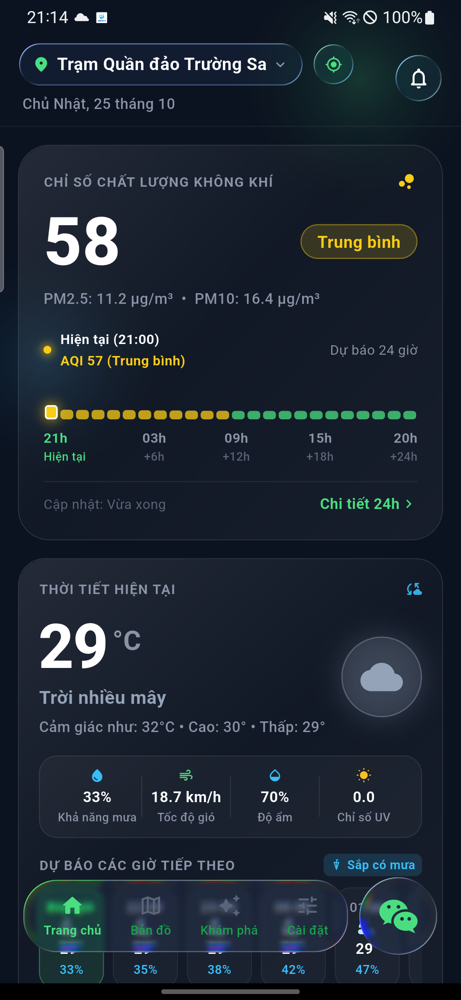
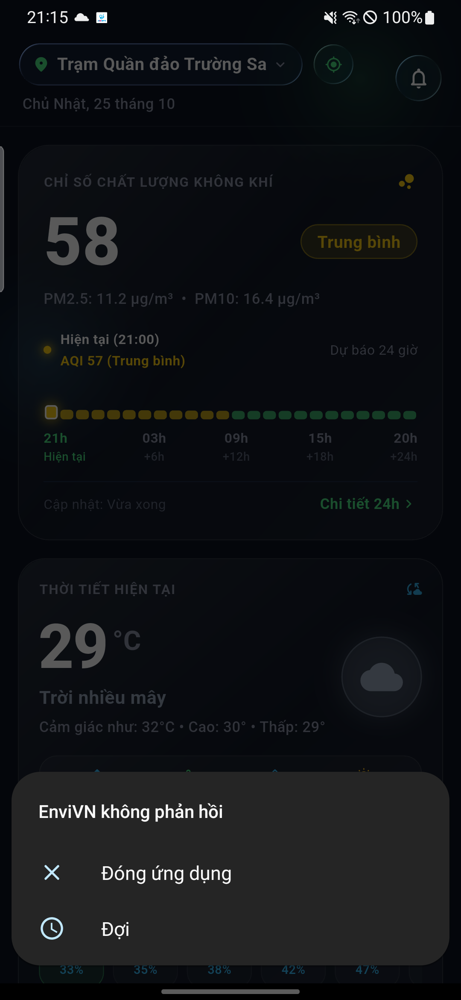

# EnviVN - Environmental Monitoring & Early-Warning Intelligence System

<div align="center">

[](https://flutter.dev)
[](https://dart.dev)
[](https://blog.cleancoder.com/uncle-bob/2012/08/13/the-clean-architecture.html)
[](https://bloclibrary.dev)
[-orange?logo=google)](https://ai.google.dev/gemma)
[-brightgreen?logo=checkmarx)](https://github.com)
[](https://dart.dev/tools/analysis)
[](LICENSE)

**A high-performance, privacy-first environmental intelligence and early-warning mobile application
for Vietnam.**  
Real-time air quality tracking (US AQI), high-precision hyper-local meteorology, urban flood
vulnerability alerts, satellite thermal radiation anomaly detection (NASA FIRMS), and on-device Edge
AI health advisories powered by Google Gemma.

[English](#english-documentation) • [Tiếng Việt](#bản-hướng-dẫn-tiếng-việt-vietnamese)

</div>

---

<a name="english-documentation"></a>

# English Documentation

## Table of Contents

1. [System Overview & Value Proposition](#1-system-overview--value-proposition)
2. [Visual Walkthrough & Screenshot Gallery](#2-visual-walkthrough--screenshot-gallery)
3. [Core Feature Breakdown](#3-core-feature-breakdown)
4. [Enterprise Architecture](#4-enterprise-architecture)
5. [Key Engineering Highlights & Scientific Calculations](#5-key-engineering-highlights--scientific-calculations)
6. [Tech Stack & Dependencies](#6-tech-stack--dependencies)
7. [Installation & Local Setup](#7-installation--local-setup)
8. [Automated Testing & Quality Verification](#8-automated-testing--quality-verification)
9. [Data Attribution & References](#9-data-attribution--references)

---

## 1. System Overview & Value Proposition

EnviVN addresses urban environmental risks across Vietnam by consolidating disparate environmental
observation streams into an integrated, zero-latency mobile dashboard:

- **Hyper-Local Atmospheric Intelligence**: Hourly US EPA AQI tracking, particulate matter
  concentrations (PM2.5, PM10), and criteria pollutants (CO, NO2, SO2, O3) via Open-Meteo.
- **Microclimate & Urban Inundation Forecasting**: 24-hour predictive temperature curves, Rothfusz
  heat index stress alerts, and real-time urban drainage flood risk warnings.
- **NASA FIRMS Earth Observation**: Sub-kilometer (375m) satellite thermal anomaly detection from
  NOAA-20 & NOAA-21 VIIRS sensors, complete with Fire Radiative Power (FRP) and terrain-aware
  contextualization.
- **On-Device Edge AI Intelligence**: Complete on-device, offline-first natural language health
  advisory powered by quantized Google Gemma 2 2B (GGUF), with strict hardware RAM
  validation ($\ge 1.4\text{ GB}$ available), throttled chunk streaming, and SHA-256 integrity
  verification.
- **Single Source of Truth (SSOT)**: Unified `AppLocationEntity` bridging GPS geolocation,
  predefined municipalities, active monitoring stations, and custom dropped pins across all
  features.

---

## 2. Visual Walkthrough & Screenshot Gallery

<div align="center">
<table>
  <tr>
    <td align="center" width="25%">
      
      <br/><b>1. Home Dashboard</b>
      <br/><i>Live AQI Gauge, Weather & Quick Actions</i>
    </td>
    <td align="center" width="25%">
      
      <br/><b>2. Location Picker</b>
      <br/><i>Administrative Regions & GPS Lock</i>
    </td>
    <td align="center" width="25%">
      
      <br/><b>3. GIS Pollution Map</b>
      <br/><i>Interactive Vector Tile Map</i>
    </td>
    <td align="center" width="25%">
      
      <br/><b>4. Station & Pin Preview</b>
      <br/><i>Proximity Metrics & Dynamic Data</i>
    </td>
  </tr>
  <tr>
    <td align="center" width="25%">
      
      <br/><b>5. Layer Switcher</b>
      <br/><i>AQI, Weather, Flood & NASA FIRMS</i>
    </td>
    <td align="center" width="25%">
      
      <br/><b>6. 24H Analytics</b>
      <br/><i>Hourly Charts & Pollutant Grids</i>
    </td>
    <td align="center" width="25%">
      
      <br/><b>7. Smart Health Advisor</b>
      <br/><i>Deterministic Multi-Factor Matrix</i>
    </td>
    <td align="center" width="25%">
      
      <br/><b>8. On-Device Edge AI</b>
      <br/><i>Gemma 2 2B Local Chat Assistant</i>
    </td>
  </tr>
</table>
</div>

---

## 3. Core Feature Breakdown

### 3.1. Central Ambient Intelligence Dashboard

- Dynamically rendered gauge displaying calculated US AQI bracketed according to EPA air quality
  color benchmarks.
- Current weather observations: dry-bulb temperature, apparent heat index (Rothfusz equation),
  relative humidity, wind velocity, precipitation likelihood, and ultraviolet exposure (UV Index).
- Automatic offline caching with 30-minute Time-To-Live (TTL) coordinate-based segmentation.

### 3.2. 24-Hour Trend Analytics & 7-Day Forecasting

- Custom Bézier line charts (`fl_chart`) rendering continuous 24-hour hourly particulate matter
  curves and temperature variations with strongly-typed `HourlyAqiPoint` entities.
- Comprehensive 7-day weather outlooks with daily weather codes, precipitation accumulations, and
  diurnal temperature ranges.
- Full criteria pollutant concentration grid: PM2.5, PM10, Carbon Monoxide (CO), Nitrogen
  Dioxide ($\text{NO}_2$), Sulfur Dioxide ($\text{SO}_2$), and Tropospheric Ozone ($\text{O}_3$).

### 3.3. Interactive Multi-Layer GIS Map & Dropped Pin

- Vector tile map with smooth zoom controls, interactive pan, and dynamic station clustering.
- Four operational map layers:
    1. **Air Quality (AQI)**: Color-coded station markers indicating live air quality.
    2. **Meteorology**: Station-level temperature, wind vectors, and humidity.
    3. **Urban Flood Risk**: High-risk drainage blackspots combined with real-time precipitation
       intensity.
    4. **NASA FIRMS Hotspots**: Active satellite thermal anomaly radiation detections.
- **Custom Location Dropped Pin**: Tap anywhere across Vietnam to drop an ad-hoc coordinate pin; the
  system computes the great-circle Haversine distance, resolves the nearest Vietnamese
  administrative province, and queries localized environmental data.

### 3.4. NASA FIRMS Satellite Thermal Anomaly Monitoring

- Integrates NOAA-20 & NOAA-21 VIIRS 375m Near Real-Time (NRT) satellite feeds.
- Computes Band I4 infrared brightness temperature in Celsius and evaluates Fire Radiative Power (
  FRP) in Megawatts (MW).
- Terrain classification categorizes anomalies into highland/mountainous or lowland/delta regions.
- Rate-limit resilient client: Handles 5,000 transactions / 10-minute quotas with in-flight
  deduplication and graceful fallback to stale cache on HTTP 429.

### 3.5. Dual-Tier Health & Activity Advisor

1. **Deterministic Rule Engine (0ms latency)**: Evaluates multi-factor combinations of AQI, PM2.5,
   apparent temperature, and rain probabilities to provide instant verdicts for outdoor jogging,
   window ventilation, commuting, and sensitive groups.
2. **On-Device Edge AI Assistant**: Local large language model chat powered by Google Gemma 2 2B (
   GGUF). Runs 100% on-device with zero cloud telemetry, ensuring strict user privacy.

### 3.6. Modular Story Share Card Exporter

- Exports environmental snapshots formatted in **9:16 (Story/Reel)** and **1:1 (Square)** aspect
  ratios.
- Flexible modular cards with interactive 4-way arrow controls to reorder and configure shared
  metrics.

---

## 4. Enterprise Architecture

EnviVN is architected according to **Clean Architecture** combined with the **BLoC / Cubit** state
management pattern. Dependencies point strictly inward, decoupling domain rules from frameworks,
networking libraries, and databases.

```
                    ┌─────────────────────────────────────────┐
                    │           PRESENTATION LAYER            │
                    │   Pages, Widgets, BLoC / Cubits, States  │
                    └────────────────────┬────────────────────┘
                                         │ depends on
                                         ▼
                    ┌─────────────────────────────────────────┐
                    │              DOMAIN LAYER               │
                    │   Entities, Repository Interfaces, Enums │
                    └────────────────────▲────────────────────┘
                                         │ implemented by
                    ┌────────────────────┴────────────────────┐
                    │          INFRASTRUCTURE LAYER           │
                    │  Repositories, API Clients, Local Cache │
                    └─────────────────────────────────────────┘
                                         │
                    ┌────────────────────┴────────────────────┐
                    │           CORE & COMMON LAYER           │
                    │  Dependency Injection (GetIt), Utilities│
                    └─────────────────────────────────────────┘
```

### Directory Structure

```
lib/
├── main.dart                               # Application bootstrap & DI initialization
└── src/
    ├── common/                             # App-wide constants, design tokens, helpers
    │   ├── constants/                      # UIColors (Dark Navy/Liquid Glass palette), Strings
    │   ├── extensions/                     # Context and primitive extensions
    │   └── utils/                          # Pure mathematical engines (AQI, Haversine, HeatIndex)
    ├── core/                               # Core foundational infrastructure
    │   ├── di/                             # Service locator registration (GetIt setup)
    │   ├── domain/entities/                # BaseResult, AppLocationEntity, ModelDownloadState
    │   │   └── enum/                       # LocationOriginType, PopularLocation domain enums
    │   ├── infrastructure/
    │   │   ├── configs/                    # EnvConfig (.env parser)
    │   │   ├── datasources/local/          # LocalStorage (SharedPreferences TTL cache)
    │   │   ├── datasources/network/        # RestfulRequest (HTTP wrapper, deduplication)
    │   │   └── services/                   # LocationService, ModelDownloadService, EdgeAiService
    │   └── presentation/                   # Shared UI primitives (AppText, AppIcon, Dialogs)
    ├── features/                           # Independent domain feature modules
    │   ├── advisor/                        # Health & Activity Advisor + Gemma 2B Edge AI
    │   ├── air_quality/                    # Real-time AQI tracking & pollutant metrics
    │   ├── details/                        # 24H hourly trends & 7-day meteorological forecasts
    │   ├── explore/                        # Regional environmental news & utilities
    │   ├── home/                           # Central dashboard orchestration
    │   ├── map/                            # Multi-layer GIS, Custom Pin & NASA FIRMS
    │   └── story_share/                    # Aspect-ratio adaptable story card exporter
    └── shared/                             # Cross-feature reusable widgets & routing
        ├── router/                         # Global navigation keys & routes
        └── widgets/                        # Liquid Glass containers, AppButton, AppTopToast
```

---

## 5. Key Engineering Highlights & Scientific Calculations

### 5.1. On-Device Edge AI Architecture & Memory Throttling

- **Quantized Model**: Utilizes Google Gemma 2 2B Instruct GGUF (`Q4_K_M`, ~1.4 GB).
- **RAM Guard**: Before initiating model download or loading weights into native memory,
  `ModelDownloadService` queries hardware memory via platform channel (`getAvailableRamBytes`).
  Execution halts with actionable advice if available RAM is $< 1.4\text{ GB}$.
- **Throttled Streaming**: Download progress updates emit across the UI stream throttled
  to $\ge 150\text{ ms}$ intervals or $\ge 0.5\%$ delta increments, completely eliminating UI thread
  thrashing.
- **SHA-256 Verification**: Completed model downloads undergo cryptographic checksum validation
  against a pre-configured hash prior to file system commitment.

### 5.2. Air Quality Index Interpolation (`AQIHelper`)

Converts raw particulate concentrations ($\mu\text{g}/\text{m}^3$) into standard US EPA Air Quality
Index values via piecewise linear interpolation:

$$I = \frac{I_{\text{high}} - I_{\text{low}}}{C_{\text{high}} - C_{\text{low}}} (C - C_{\text{low}}) + I_{\text{low}}$$

Where $C$ is the measured concentration, $[C_{\text{low}}, C_{\text{high}}]$ are the pollutant
breakpoint concentrations, and $[I_{\text{low}}, I_{\text{high}}]$ are the corresponding AQI index
category boundaries.

### 5.3. Apparent Heat Index Polynomial (`HeatIndexHelper`)

Calculates perceived temperature from dry-bulb temperature ($T$ in $^\circ\text{F}$) and relative
humidity ($RH$) using the multivariate Rothfusz regression equation:

$$\text{HI} = -42.379 + 2.04901523 T + 10.14333127 RH - 0.22475541 T \cdot RH - 6.83783 \times 10^{-3} T^2 - 5.481717 \times 10^{-2} RH^2 + 1.22874 \times 10^{-3} T^2 \cdot RH + 8.5282 \times 10^{-4} T \cdot RH^2 - 1.99 \times 10^{-6} T^2 \cdot RH^2$$

### 5.4. Spherical Great-Circle Distance (`GeoDistanceHelper`)

Computes distance between coordinates on a spherical Earth ($R = 6,371\text{ km}$) using the
Haversine formulation:

$$a = \sin^2\left(\frac{\Delta\phi}{2}\right) + \cos(\phi_1)\cos(\phi_2)\sin^2\left(\frac{\Delta\lambda}{2}\right)$$
$$d = 2R \cdot \text{atan2}\left(\sqrt{a}, \sqrt{1-a}\right)$$

### 5.5. Resilient Network & Caching Infrastructure

- **Coordinate-Aware TTL Caching**: Keyed by rounded coordinates $(\text{lat}, \text{lon})$ with
  automatic expiration (30 minutes for weather/AQI, 15 minutes for NASA FIRMS).
- **Request Deduplication**: In-flight HTTP requests for identical endpoints share a single network
  call.
- **HTTP 429 Cooldown**: Automatic graceful fallback to stale cache when upstream API rate limits
  are encountered.

---

## 6. Tech Stack & Dependencies

| Category                 | Technology / Package            | Purpose                                            |
|--------------------------|---------------------------------|----------------------------------------------------|
| **Framework**            | Flutter 3.22+ / Dart 3.12+      | High-performance multi-platform UI engine          |
| **State Management**     | `flutter_bloc` & `equatable`    | Deterministic, unidirectional state management     |
| **Dependency Injection** | `get_it`                        | Fast service locator and dependency inversion      |
| **On-Device Edge AI**    | `flutter_gemma`                 | Quantized on-device LLM inference                  |
| **GIS & Mapping**        | `flutter_map` & `latlong2`      | High-fps OpenStreetMap vector tile rendering       |
| **Data Visualization**   | `fl_chart`                      | Smooth 24-hour Bézier curves and pollutant charts  |
| **Networking**           | `http`                          | Low-overhead REST client with connection pooling   |
| **Storage & Caching**    | `shared_preferences`            | Key-value offline persistence and TTL caches       |
| **Hardware Access**      | `geolocator`                    | High-accuracy GPS positioning and permission flows |
| **UI Polish**            | `liquid_glass_renderer` & `gap` | Modern translucent glassmorphism aesthetics        |

---

## 7. Installation & Local Setup

### 7.1. Prerequisites

- **Flutter SDK**: `^3.22.0` (Dart SDK `^3.12.0`)
- **Git**
- **Android Studio** (with Android SDK & NDK) or **VS Code** with Flutter extension
- **Xcode 15+** (for macOS / iOS compilation)

### 7.2. Environment Configuration

Create a `.env` file from the provided template:

```bash
# Windows PowerShell:
Copy-Item .env_example .env

# macOS / Linux:
cp .env_example .env
```

Ensure `.env` contains valid endpoints and your NASA FIRMS key:

```properties
APP_NAME=EnviVN
APP_ENV=development
OPEN_METEO_WEATHER_BASE_URL=https://api.open-meteo.com
OPEN_METEO_AIR_QUALITY_BASE_URL=https://air-quality-api.open-meteo.com
OPEN_METEO_GEOCODING_BASE_URL=https://geocoding-api.open-meteo.com
OSM_TILE_URL=https://tile.openstreetmap.org/{z}/{x}/{y}.png
MAP_USER_AGENT=com.envivn.envivn
NASA_FIRMS_BASE_URL=https://firms.modaps.eosdis.nasa.gov/api
NASA_FIRMS_MAP_KEY=your_nasa_firms_key_here
GEMMA_MODEL_DOWNLOAD_URL=https://huggingface.co/bartowski/gemma-2-2b-it-GGUF/resolve/main/gemma-2-2b-it-Q4_K_M.gguf
HF_TOKEN=
```

> Obtain your free NASA FIRMS MAP Key
> at: [https://firms.modaps.eosdis.nasa.gov/api/map_key](https://firms.modaps.eosdis.nasa.gov/api/map_key)

### 7.3. Run Application

```bash
# Install dependencies
flutter pub get

# Run on connected device or emulator
flutter run
```

### 7.4. Release APK Compilation

```bash
# Optimized 64-bit release APK (~23MB, recommended for modern devices):
flutter build apk --split-per-abi

# Universal Fat APK (~59MB):
flutter build apk --release
```

---

## 8. Automated Testing & Quality Verification

EnviVN enforces 100% test pass rates and zero analyzer issues prior to any release:

```bash
# 1. Run static code analysis (Expected: 0 issues)
flutter analyze

# 2. Verify code formatting compliance
dart format --output=none --set-exit-if-changed lib test

# 3. Execute the full test suite (103 unit and widget tests)
flutter test
```

### Test Coverage Highlights

- **104/104 Tests Passing (100%)**:
    - `ModelDownloadService`: Lifecycle, chunk throttling, RAM boundary checks, and SHA-256
      verification.
    - `EdgeAiInferenceService`: Model initialization, streaming chunk yielding, and error recovery.
    - `AirQualityCubit`, `DetailsCubit`, `AdvisorCubit`, `HomeDashboardCubit`, `MapCubit`: Complete
      BLoC transition and error state coverage.
    - `Aqi24hChartCard`, `StoryCardView`, `StationMarkerWidget`: Zero-overflow widget tests across
      320px narrow screens.
    - `GeoDistanceHelper`, `AQIHelper`, `HeatIndexHelper`: Exact mathematical boundary checks.

---

## 9. Data Attribution & References

- **Meteorological & Air Quality Feeds**: Open-Meteo under standard API license.
- **Satellite Earth Observation**: NASA FIRMS (NOAA-20 and NOAA-21 VIIRS Near Real-Time).
- **Map Base Tiles**: OpenStreetMap contributors.
- **Air Quality Standards**: US EPA Air Quality Index (AQI) & Vietnam QCVN 05:2023/BTNMT.
- **Thermal Heat Risk Guidelines**: National Oceanic and Atmospheric Administration (NOAA) / NWS.

---

---

<a name="bản-hướng-dẫn-tiếng-việt-vietnamese"></a>

# Bản Hướng Dẫn Tiếng Việt (Vietnamese)

## Mục Lục

1. [Giới Thiệu Hệ Thống & Giá Trị Thực Tiễn](#1-giới-thiệu-hệ-thống--giá-trị-thực-tiễn)
2. [Giao Diện Trực Quan Ứng Dụng](#2-giao-diện-trực-quan-ứng-dụng)
3. [Chi Tiết Tính Năng Cốt Lõi](#3-chi-tiết-tính-năng-cốt-lõi)
4. [Kiến Trúc Phần Mềm Doanh Nghiệp (Clean Architecture)](#4-kiến-trúc-phần-mềm-doanh-nghiệp-clean-architecture)
5. [Thuật Toán & Phương Pháp Tính Khoa Học](#5-thuật-toán--phương-pháp-tính-khoa-học)
6. [Cấu Hình & Khởi Chạy Dự Án](#6-cấu-hình--khởi-chạy-dự-án)
7. [Kiểm Thử Tự Động & Đảm Bảo Chất Lượng](#7-kiểm-thử-tự-động--đảm-bảo-chất-lượng)
8. [Nguồn Dữ Liệu & Bản Quyền](#8-nguồn-dữ-liệu--bản-quyền)

---

## 1. Giới Thiệu Hệ Thống & Giá Trị Thực Tiễn

**EnviVN** là giải pháp di động toàn diện nhằm giám sát môi trường sống và đưa ra các cảnh báo rủi
ro thời tiết sớm tại Việt Nam:

- **Giám sát chất lượng không khí thời gian thực**: Chỉ số US AQI, nồng độ bụi mịn PM2.5, PM10 và
  các khí độc hại (CO, $\text{NO}_2$, $\text{SO}_2$, $\text{O}_3$).
- **Cảnh báo vi khí hậu & ngập lụt đô thị**: Đồ thị nhiệt độ 24 giờ, chỉ số sốc nhiệt Heat Index (
  Rothfusz), và bản đồ điểm đen ngập úng khi mưa lớn.
- **Quan trắc điểm nhiệt vệ tinh NASA FIRMS**: Thu nhận dữ liệu hồng ngoại thời gian thực từ vệ tinh
  NOAA-20/21 VIIRS (độ phân giải 375m) trên toàn lãnh thổ Việt Nam.
- **Trợ lý AI Cố vấn Sức khỏe chạy On-Device (Edge AI)**: Trò chuyện và phân tích khuyến nghị sức
  khỏe hoàn toàn ngoại tuyến với mô hình Google Gemma 2 2B (GGUF), bảo mật tuyệt đối dữ liệu người
  dùng, kiểm soát RAM an toàn ($\ge 1.4\text{ GB}$).
- **Single Source of Truth (SSOT)**: Chuẩn hóa thực thể vị trí duy nhất `AppLocationEntity` xuyên
  suốt toàn bộ ứng dụng (GPS, thành phố mặc định, trạm quan trắc và điểm ghim tự do).

---

## 2. Giao Diện Trực Quan Ứng Dụng

<div align="center">
<table>
  <tr>
    <td align="center" width="25%">
      
      <br/><b>1. Bảng điều khiển chính</b>
      <br/><i>Vòng đo AQI, Thời tiết & Truy cập nhanh</i>
    </td>
    <td align="center" width="25%">
      
      <br/><b>2. Chọn Tỉnh / Thành phố</b>
      <br/><i>Định vị GPS & Danh mục 63 tỉnh</i>
    </td>
    <td align="center" width="25%">
      
      <br/><b>3. Bản đồ GIS ô nhiễm</b>
      <br/><i>Tương tác trượt, zoom mượt mà</i>
    </td>
    <td align="center" width="25%">
      
      <br/><b>4. Thẻ trạm & Ghim vị trí</b>
      <br/><i>Tính khoảng cách & dữ liệu tức thời</i>
    </td>
  </tr>
  <tr>
    <td align="center" width="25%">
      
      <br/><b>5. Lớp bản đồ chuyên dụng</b>
      <br/><i>AQI, Thời tiết, Ngập úng & Vệ tinh</i>
    </td>
    <td align="center" width="25%">
      
      <br/><b>6. Phân tích xu hướng 24h</b>
      <br/><i>Đồ thị Bézier & Lưới chất ô nhiễm</i>
    </td>
    <td align="center" width="25%">
      
      <br/><b>7. Cố vấn sức khỏe thông minh</b>
      <br/><i>Ma trận đa yếu tố phản hồi tức thì</i>
    </td>
    <td align="center" width="25%">
      
      <br/><b>8. Trợ lý AI On-Device</b>
      <br/><i>Gemma 2 2B trò chuyện ngoại tuyến</i>
    </td>
  </tr>
</table>
</div>

---

## 3. Chi Tiết Tính Năng Cốt Lõi

### 3.1. Bảng Điều Khiển Môi Trường Trung Tâm

- Vòng tròn đồng hồ đo AQI hiển thị màu sắc và mức đánh giá theo chuẩn US EPA.
- Tích hợp đầy đủ: nhiệt độ thực, nhiệt độ cảm nhận (Heat Index), độ ẩm, tốc độ gió, xác suất mưa và
  tia UV.
- Cơ chế lưu đệm ngoại tuyến (TTL 30 phút) theo từng tọa độ địa lý.

### 3.2. Phân Tích Diễn Biến 24 Giờ & Dự Báo 7 Ngày

- Đồ thị đường cong Bézier 24 giờ liên tục thể hiện xu hướng biến thiên của chỉ số ô nhiễm không khí
  và nhiệt độ (sử dụng thực thể định kiểu mạnh `HourlyAqiPoint`).
- Dự báo thời tiết 7 ngày với mã thời tiết trực quan, lượng mưa tích lũy và biên độ nhiệt ngày/đêm.
- Lưới chi tiết nồng độ các chất ô nhiễm: PM2.5, PM10,
  CO, $\text{NO}_2$, $\text{SO}_2$, $\text{O}_3$.

### 3.3. Bản Đồ Môi Trường Đa Tầng & Ghim Tọa Độ Tùy Chọn

- Bản đồ vector mượt mà với 4 lớp nghiệp vụ chuyên sâu:
    1. **Chất lượng không khí (AQI)**: Hiển thị các trạm đo kèm mức độ ô nhiễm màu sắc.
    2. **Thời tiết**: Trực quan hóa nhiệt độ, hướng gió và độ ẩm tại từng vùng.
    3. **Ngập úng đô thị**: Kết hợp điểm đen thoát nước lịch sử với lượng mưa tức thời.
    4. **Vệ tinh NASA FIRMS**: Phát hiện điểm phát xạ nhiệt mặt đất.
- **Tính năng Ghim Vị Trí Tự Do**: Chạm vào bất kỳ điểm nào trên toàn lãnh thổ Việt Nam; ứng dụng tự
  động tính khoảng cách Haversine, tìm tỉnh thành gần nhất và tải dữ liệu môi trường cục bộ.

### 3.4. Điểm Phát Xạ Nhiệt Vệ Tinh NASA FIRMS

- Dữ liệu vệ tinh thời gian thực (NRT) từ cảm biến NOAA-20 & NOAA-21 VIIRS (độ phân giải 375m).
- Tính toán nhiệt độ phát xạ hồng ngoại kênh I4 (Celsius) và công suất phát xạ nhiệt Fire Radiative
  Power (FRP tính bằng MW).
- Phân loại thông minh theo địa hình: vùng cao đồi núi hoặc vùng đồng bằng châu thổ.
- Chống nghẽn mạng: Tự động phục hồi và dùng bộ nhớ đệm an toàn khi chạm hạn ngạch HTTP 429.

### 3.5. Hệ Thống Cố Vấn Sức Khỏe Kép

1. **Động cơ phân tích quy tắc (0ms độ trễ)**: Đánh giá ngay lập tức ma trận đa yếu tố (AQI, bụi
   mịn, nhiệt độ, mưa giông) để đưa ra lời khuyên thể thao ngoài trời, mở cửa thông gió, đi lại và
   bảo vệ người già, trẻ nhỏ.
2. **Trợ lý AI On-Device (Gemma 2 2B)**: Mô hình ngôn ngữ lớn chạy trực tiếp trên chip di động,
   không gửi dữ liệu ra ngoài Internet, đảm bảo an toàn tuyệt đối quyền riêng tư.

### 3.6. Xuất Thẻ Ảnh Story Mạng Xã Hội

- Tạo và xuất thẻ ảnh định dạng chuẩn **9:16 (Story/Reel)** và **1:1 (Vuông)**.
- Hỗ trợ đổi chỗ các thẻ linh hoạt với các nút điều hướng 4 chiều chống tràn màn hình.

---

## 4. Kiến Trúc Phần Mềm Doanh Nghiệp (Clean Architecture)

Mã nguồn EnviVN áp dụng chặt chẽ mô hình **Clean Architecture** kết hợp BLoC/Cubit:

```
lib/
├── main.dart                               # Điểm khởi chạy ứng dụng & Dependency Injection
└── src/
    ├── common/                             # Quy chuẩn giao diện, màu sắc, hằng số dùng chung
    ├── core/                               # Nền tảng hạ tầng cốt lõi
    │   ├── di/                             # Đăng ký Service Locator (GetIt)
    │   ├── domain/entities/                # Thực thể gốc: BaseResult, AppLocationEntity
    │   │   └── enum/                       # Thư mục enum chuẩn hóa: LocationOriginType, PopularLocation
    │   ├── infrastructure/
    │   │   ├── configs/                    # Trình nạp biến môi trường (.env)
    │   │   ├── datasources/local/          # LocalStorage (Bộ nhớ đệm TTL SharedPreferences)
    │   │   ├── datasources/network/        # RestfulRequest (HTTP Client chuẩn, khử trùng lặp)
    │   │   └── services/                   # LocationService, ModelDownloadService, EdgeAiService
    │   └── presentation/                   # Widget giao diện dùng chung (AppText, Dialog, Tag)
    ├── features/                           # Các module tính năng nghiệp vụ độc lập
    │   ├── advisor/                        # Cố vấn sức khỏe & Trợ lý Edge AI
    │   ├── air_quality/                    # Giám sát chất lượng không khí & trạm đo
    │   ├── details/                        # Xu hướng 24 giờ & dự báo thời tiết 7 ngày
    │   ├── explore/                        # Tiện ích môi trường & tin tức
    │   ├── home/                           # Bảng điều khiển trung tâm (Dashboard)
    │   ├── map/                            # Bản đồ đa tầng & điểm nhiệt NASA FIRMS
    │   └── story_share/                    # Xuất thẻ ảnh Story mạng xã hội
    └── shared/                             # Widget dùng chung đa tính năng & Router
```

---

## 5. Thuật Toán & Phương Pháp Tính Khoa Học

### 5.1. Cơ Chế Tải & Kiểm Soát Bộ Nhớ Edge AI

- **Mô hình lượng tử hóa**: Google Gemma 2 2B Instruct GGUF (`Q4_K_M`, ~1.4 GB).
- **Kiểm soát dung lượng RAM khả dụng**: Trước khi tải hoặc nạp trọng số mô hình vào RAM, ứng dụng
  truy vấn bộ nhớ native (`getAvailableRamBytes`). Nếu RAM khả dụng $< 1.4\text{ GB}$, hệ thống chủ
  động dừng và thông báo khuyến nghị để ngăn chặn tràn RAM (OOM Crash).
- **Tiết lưu luồng tải (Throttling)**: Tiến độ tải chỉ cập nhật lên giao diện khi trôi qua ít nhất
  150ms hoặc thay đổi $\ge 0.5\%$, giúp UI không bị giật lag khi tải tệp dung lượng lớn.
- **Xác thực mã băm SHA-256**: Tệp tải về được kiểm tra toàn vẹn bằng hàm băm SHA-256 trước khi kích
  hoạt sử dụng.

### 5.2. Công Thức Nội Suy US EPA AQI (`AQIHelper`)

Nội suy tuyến tính nồng độ chất ô nhiễm thành điểm chỉ số AQI:

$$I = \frac{I_{\text{high}} - I_{\text{low}}}{C_{\text{high}} - C_{\text{low}}} (C - C_{\text{low}}) + I_{\text{low}}$$

### 5.3. Công Thức Nhiệt Cảm Nhận Rothfusz (`HeatIndexHelper`)

Tính toán chỉ số nhiệt độ sinh lý con người cảm nhận dựa trên nhiệt độ môi trường và độ ẩm tương đối
theo phương trình đa thức hồi quy của NOAA/NWS.

### 5.4. Tính Khoảng Cách Mặt Cầu Haversine (`GeoDistanceHelper`)

Tính khoảng cách đường chim bay giữa hai cặp tọa độ địa lý trên mặt cầu Trái Đất bán
kính $R = 6,371\text{ km}$.

---

## 6. Cấu Hình & Khởi Chạy Dự Án

### 6.1. Yêu Cầu Môi Trường

- **Flutter SDK**: `>= 3.22.0` (Dart SDK `>= 3.12.0`)
- **Android Studio** hoặc **Visual Studio Code**
- **Xcode 15+** (nếu build trên thiết bị Apple)

### 6.2. Cấu Hình Tệp Môi Trường

```bash
# Tạo file .env từ mẫu:
Copy-Item .env_example .env   # Trên Windows PowerShell
cp .env_example .env          # Trên macOS / Linux
```

Cập nhật mã bản đồ NASA FIRMS vào `.env`:

```properties
APP_NAME=EnviVN
APP_ENV=development
OPEN_METEO_WEATHER_BASE_URL=https://api.open-meteo.com
OPEN_METEO_AIR_QUALITY_BASE_URL=https://air-quality-api.open-meteo.com
OPEN_METEO_GEOCODING_BASE_URL=https://geocoding-api.open-meteo.com
OSM_TILE_URL=https://tile.openstreetmap.org/{z}/{x}/{y}.png
MAP_USER_AGENT=com.envivn.envivn
NASA_FIRMS_BASE_URL=https://firms.modaps.eosdis.nasa.gov/api
NASA_FIRMS_MAP_KEY=your_nasa_firms_key_here
GEMMA_MODEL_DOWNLOAD_URL=https://huggingface.co/bartowski/gemma-2-2b-it-GGUF/resolve/main/gemma-2-2b-it-Q4_K_M.gguf
HF_TOKEN=
```

*(Đăng ký mã miễn phí tại: [NASA FIRMS API Key](https://firms.modaps.eosdis.nasa.gov/api/map_key))*

### 6.3. Chạy Ứng Dụng

```bash
flutter pub get
flutter run
```

### 6.4. Đóng Gói Bản Cài Đặt Android (Release APK)

```bash
# Bản APK tối ưu cho chip 64-bit (~23MB, khuyên dùng):
flutter build apk --split-per-abi

# Bản Fat APK (~59MB):
flutter build apk --release
```

---

## 7. Kiểm Thử Tự Động & Đảm Bảo Chất Lượng

Dự án cam kết 100% test pass rate và 0 lỗi phân tích mã trước khi đưa lên Git:

```bash
# 1. Phân tích tĩnh mã nguồn (Kết quả chuẩn: 0 lỗi, 0 cảnh báo)
flutter analyze

# 2. Kiểm tra định dạng code chuẩn Dart
dart format --output=none --set-exit-if-changed lib test

# 3. Chạy toàn bộ 103 test cases tự động
flutter test
```

### Kết Quả Kiểm Thử Thực Tế

- **104/104 Test Cases Đạt Thành Công 100%**:
    - `ModelDownloadService`: Kiểm tra vòng đời tải, tiết lưu luồng, kiểm tra ngưỡng RAM, và xác
      minh mã băm SHA-256.
    - `EdgeAiInferenceService`: Khởi tạo mô hình, trả về chunk streaming, và cơ chế tự phục hồi.
    - `AirQualityCubit`, `DetailsCubit`, `AdvisorCubit`, `HomeDashboardCubit`, `MapCubit`: Kiểm thử
      toàn bộ chuyển đổi trạng thái BLoC và ngoại lệ.
    - `Aqi24hChartCard`, `StoryCardView`, `StationMarkerWidget`: Kiểm thử giao diện chống tràn điểm
      ảnh (overflow) trên màn hình siêu hẹp (320px).
    - `GeoDistanceHelper`, `AQIHelper`, `HeatIndexHelper`: Kiểm thử tính toán độ chính xác toán học.

---

## 8. Nguồn Dữ Liệu & Bản Quyền

- Dữ liệu dự báo thời tiết và chất lượng không khí: Open-Meteo API.
- Dữ liệu điểm phát xạ nhiệt vệ tinh thời gian thực: NASA FIRMS (NOAA-20 và NOAA-21 VIIRS).
- Bản đồ nền: OpenStreetMap contributors.
- Tiêu chuẩn quy chuẩn chất lượng không khí: US EPA AQI & QCVN 05:2023/BTNMT.
